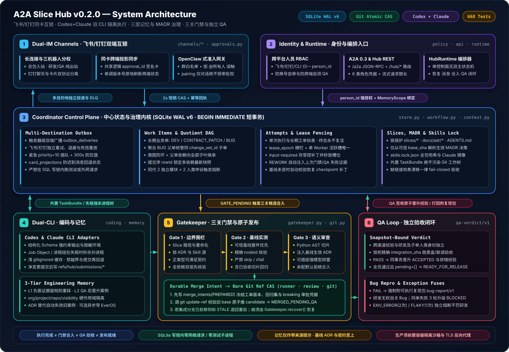
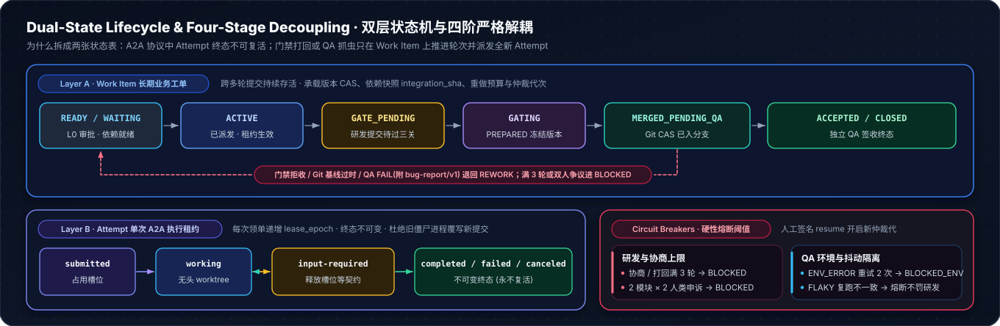
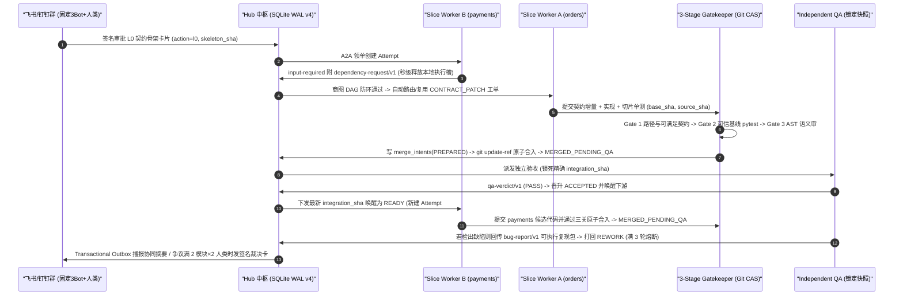

# A2A Slice Hub (v0.1.0)

> **Multi-agent parallel slice development coordinator** — vertical slice ownership (`slices/*.yaml`), SQLite WAL dual-state orchestration, 3-stage Git atomic CAS gatekeeper, independent snapshot-bound QA closed loop, and Feishu / DingTalk collaboration mirroring.  
> MIT Licensed · Python 3.11+ · Real Git Worktrees & CAS · 447 Automated Adversarial Tests

[**System Architecture**](#architecture-overview) · [**Lifecycle & Sequence**](#dual-state-lifecycle--collaboration-flow) · [**Module Map**](#source-module-map) · [**Quickstart**](#local-development) · [**Protocol Matrix**](#a2a-json-rpc-protocol-reference) · [**Security Boundaries**](SECURITY.md) · [**State Machine**](docs/state_transitions.md) · [**中文总体架构蓝图**](docs/architecture_blueprint.md)

---

**v0.1.0: a complete, inspectable open-source reference coordinator**, hardened
across five adversarial engineering rounds ([Round 1](docs/round1_report.md) ·
[Round 2](docs/round2_report.md) · [Round 3](docs/round3_report.md) ·
[Round 4](docs/round4_report.md) · [Round 5](docs/round5_report.md)). Complete
refers to the bounded reference workflow below, not a turnkey production platform
or full A2A conformance.

## Architecture overview

  

### Dual-state lifecycle & collaboration flow

  

### Source module map

| Plane | Module | Core Responsibility |
|---|---|---|
| **Ingress & Schemas** | `src/a2a_slice_hub/api.py` `src/a2a_slice_hub/models.py` | 6-role Bearer auth, Hub REST (`/hub/*`), bounded A2A 0.3 JSON-RPC (`/a2a`), Feishu/DingTalk webhook ingress |
| **Coordinator Core** | `src/a2a_slice_hub/store.py` `src/a2a_slice_hub/workflow.py` | SQLite WAL v4 (`BEGIN IMMEDIATE`), `work_items` × `attempts` CAS, quotient-graph DAG, dependency routing, Outbox aging & DLQ |
| **Slice & Governance** | `src/a2a_slice_hub/slices.py` `src/a2a_slice_hub/approvals.py` | Protected `slices/*.yaml` ownership registry, contract provider lookup, version/digest-bound HMAC approval cards (`l0`, `breaking_contract`, `resume`) |
| **3-Stage Gatekeeper** | `src/a2a_slice_hub/gatekeeper.py` `src/a2a_slice_hub/paths.py` `src/a2a_slice_hub/runner.py` `src/a2a_slice_hub/review.py` | Slice path & file-mode fence, Positive Habitable JSON Schema evolution check, baseline-owned exact-`nodeid` pytest runner, AST caller extraction & semantic review |
| **Git & Execution** | `src/a2a_slice_hub/git.py` `src/a2a_slice_hub/worker.py` `src/a2a_slice_hub/experience.py` | Detached Git worktrees, immutable merge commits, `git update-ref` atomic CAS, lease-renewing worker slot, opt-in redacted `EverOSHook` |
| **IM Mirroring** | `src/a2a_slice_hub/im.py` `src/a2a_slice_hub/config.py` | 3-bot `FeishuAdapter`, `DingTalkAdapter` (Webhook & OpenAPI), signature verifiers, `OutboxDispatcher`, YAML app factory |

## What is implemented

- Local-disk SQLite WAL, explicit write transactions, item/attempt separation,
  version CAS, lease epochs, worker-slot fencing, atomic dependency-cycle checks.
- One-level aggregate BUG parents with atomic change-set children and independent,
  snapshot-bound QA. A completed execution is not an accepted business result.
- Actual Git subprocesses: bare repositories in tests, detached worktrees,
  rename endpoint and file-mode checks, immutable candidate commits, exact ref CAS.
- Baseline-owned pytest suites with explicit required/regression node IDs; collection,
  passing calls, skips and xfails are checked. Default execution is fail-closed.
- Durable merge intent/reconciliation across the SQLite/Git commit boundary.
- Pluggable semantic review with Python AST caller snippets; no default auto-approval.
- FastAPI role-authenticated Hub APIs, a project-specific task REST API, and a
  deliberately limited A2A 0.3 JSON-RPC implementation (not full conformance).
- Protected SliceRegistry, authenticated human-to-machine binding, offline owner mentions,
  dependency patch routing, L0 approval, release sealing and typed QA retry budgets.
- HMAC approval cards, idempotent inbound task messages, leased transactional outbox,
  three-identity Feishu adapter, explicit opt-in experience hooks.

## Local development

Quickstart (Python 3.11+, Git and uv): run `uv sync --group dev`, set the secret
environment variables referenced by `examples/hub.yaml`, then use the API launch
command below. Dependency downloads must use your environment's approved download
proxy; the test suite itself is offline. Use the existing virtual environment when available. Dependencies and development
tools are declared in `pyproject.toml` and `uv.lock`.

Windows PowerShell:

~~~powershell
.\.venv\Scripts\pytest.exe -q
~~~

Linux/macOS:

~~~sh
.venv/bin/pytest -q
~~~

Tests never download data or call a real IM/model service. Git and SQLite are real;
semantic reviewer verdicts and IM HTTP responses are explicit test doubles. Git
repositories, SQLite files and worktrees are placed under pytest temporary roots.

Dependency installation, if needed, must follow your environment's download/proxy
policy. Do not copy private proxy credentials into this repository.

## Launch the API

Set every credential environment variable named in `examples/hub.yaml` through a
secret manager or your shell, each to a distinct randomly generated value of at
least 32 characters. Set the approval key separately. Never commit their values.
Then, from the repository root:

~~~sh
python -m a2a_slice_hub --config examples/hub.yaml
~~~

The sample listens on localhost. Install the package into the selected environment
before using the module entrypoint. TLS/authenticated reverse proxy deployment is an
operator responsibility; exposing the development server publicly is not supported.
The sample enables the API only: setting a bare repository enables the gate route,
but a trusted `SemanticReviewer` and runner policy must also be supplied through the
application factory before merges can pass. No credentials, bot applications, model
accounts or external services are automatically provisioned.

## Test manifest and integration

QA owns `.hub/tests.json` in the integration baseline. Copy the shape from
`examples/test-manifest.json`: `required[slice_id]` lists this slice's test node IDs;
`accepted` lists already accepted regression node IDs. Both sets plus `required` tests for every dynamically accepted slice run for a candidate.
`pending` must explicitly be `[]` before an Epic can become `READY_FOR_RELEASE`.
Tests must live below `tests/`; all selected IDs must be collected and pass, with no
skip/xfail. This is stronger than a test-count threshold. Update the manifest through
a reviewed trusted-baseline change, never a worker-owned source branch.

A worker commits inside a disposable worktree and submits full base/source object
IDs. Gatekeeper verifies its diff, combines whole change sets, runs the trusted
suite, requests semantic review, freezes item versions in a durable intent, and
performs `git update-ref <ref> <candidate> <base>`. A moved base invalidates the result.
QA later attests the exact merged snapshot; it alone accepts work or closes BUGs.

Call `Gatekeeper.recover()` at startup before accepting new merges. A PREPARED intent
blocks that branch until reconciliation. Only the Hub may mutate integration refs;
force-push and external garbage collection during an in-flight operation are outside
the supported administrative contract. Candidate/submission refs retain objects;
retention pruning is deliberately not automatic in v0.1.

## Deliberate limits

- SQLite is **one Hub, local disk**, not a shared NFS/SMB database or multi-Hub HA.
- A worktree is **not** a hostile-code sandbox. Local runner opt-in is for trusted
  code only; deploy a low-privilege/container runner before adversarial execution.
- Contract edits require `CONTRACT_PATCH` authority. The **bounded producer-additive contract evolution policy**
  permits only optional new properties with an unchanged required set and an open
  original object. New fields (including referenced definitions) must satisfy the
  Positive Habitable Additive Profile: positive type/object/array structure, nonempty
  enum of JSON primitives/objects, const and acyclic local refs, with a constructible valid value. Boolean schemas,
  complex constraints, combinators, cycles and unknown keywords fail closed. Format,
  default and annotations are metadata, not format enforcement or value insertion.
  This is **not general bidirectional JSON Schema entailment**: an old payload that
  already used an unknown property with a different type may fail the new schema. Breaking
  changes need a signed, exact-diff/version/change-set approval. This is not general
  JSON Schema entailment or proof of runtime default materialization.
- Python AST extraction is advisory, not a complete cross-language call graph.
- A2A implements `message/send`, `tasks/get`, and `tasks/cancel` with constraints.
  Structured dependency and QA bug-report data parts are supported.
  No streaming, push subscriptions, arbitrary continuation, or conformance
  certification. `/a2a/tasks` is an extension, not a standard binding claim.
- Feishu has outbound HTTP plus signed plaintext HTTP event/card callbacks. Signatures,
  timestamp windows, replay receipts and registered human approver mapping are checked.
  Encrypted envelopes are rejected, not parsed as trusted plaintext. Live bot provisioning,
  encrypted-payload handling and long-connection transport remain deployment work.
  The legacy authenticated gateway path is read-only and cannot approve cards.
- Outbox is at-least-once. Provider deduplication/reconciliation remains necessary.
- Release readiness and QA retry/fuse states are implemented. External schedulers still
  need to drive heartbeats, retry QA, dispatch Outbox and recover prepared merges.
  Production QA sandbox provisioning, versioned registry hot-reload, encrypted Feishu
  envelopes and multi-round model review convergence remain follow-up work.

## HTTP workflow

1. Worker credentials contain `name` (machine ID), `role=worker`, `owner_user_id`.
   POST `/hub/workers/heartbeat` with `endpoint_url`, `skills`, and bounded `ttl`.
   User ownership cannot be supplied or overridden in the body. Backup users are
   recorded but are not silently granted takeover authority.
2. Coordinator creates an Epic at a verified integration head and creates its items
   with `epic_id`. Issue `/hub/approvals` with `action=l0` and the exact
   `{skeleton_sha, branch}` subject. Registered human approval unlocks children.
3. A working attempt sends `input-required` with `artifact.dependency_request`:
   `{schema_version: "dependency-request/v1", contract: "orders", expected_change: {...}}`.
   The same data can be carried in one A2A `kind=data` Part with `taskId`, `contextId`,
   `metadata.lease_epoch` and `metadata.expected_state_version`.
4. Only merged AND QA-accepted dependencies wake downstream work. Obtain the new
   `integration_sha` from the item and start a new attempt; old attempts are canceled.
5. QA sends `outcome=PASS|FAIL|ENV_ERROR|FLAKY`. FAIL requires `bug-report/v1`;
   initial FLAKY requires `report.observed=PASS|FAIL`. One consistent rerun goes
   through normal PASS/FAIL handling; inconsistency blocks without a development penalty.
6. `/hub/epics/{id}/release` checks exact QA-attested head, all accepted/closed items,
   no prepared merges and an explicit empty manifest `pending` list. It seals the Epic;
   it does NOT deploy software.

For Windows restricted-token CI where Python 3.13 `mkdir(mode=0700)` drops inherited
access, the test-only launcher preserves the inherited workspace ACL for NEW temporary
directories. It neither changes existing ACLs nor skips any tests:

~~~powershell
$env:TEMP = "$PWD\.codex_round5_tmp"
$env:TMP = $env:TEMP
New-Item -ItemType Directory -Force .codex_round5_tmp | Out-Null
.\.venv\Scripts\python.exe tests/run_windows_inherited_temp.py -W error -p no:cacheprovider --basetemp=.codex_round5_tmp/full -q
~~~

The ordinary pytest command remains the host-native acceptance command. Do not confuse
a passing launcher run with proof that an inaccessible pre-existing `.pytest_tmp` was repaired.

## A2A JSON-RPC protocol reference

`/a2a` `message/send` accepts these **Hub application data schemas**, not claims
of additional official A2A methods:

- `task-status/v1`: `state: working`, with taskId/contextId and lease metadata.
- `dev-submission/v1`: `state: completed` (default), `base_sha`, `source_sha`, optional artifact.
- `qa-verdict/v1`: exact `integration_sha`, `outcome: PASS|FAIL|ENV_ERROR|FLAKY`, optional report.
- `gate-merge/v1`: `branch`, `attempt_ids`; coordinator/gatekeeper only.

Lease metadata uses `lease_epoch` and `expected_state_version`; QA metadata uses
work-item `expected_state_version`. Retries must retain messageId AND the entire
message content. New receipts return the original snapshot, not the latest task.
Use tasks/get for the current state. Legacy ID-only receipts remain readable.

Outbox has capped exponential retries (5 attempts by default), safe error diagnostics,
and coordinator-only `GET /hub/outbox/dead-letters?limit=100`. Delivery remains at-least-once.
Feishu and DingTalk implement the same `IMAdapter.send` protocol and Chinese summaries.
DingTalk supports robot Webhook and enterprise OpenAPI Markdown; inject credentials
at runtime. Map `coordinator` to an actual provider identity for a real notification.
DingTalk robot callbacks use `/im/dingtalk/events` behind a bearer-authenticated
`im_gateway`, timestamp signature and an explicit staff-to-user allowlist. They do
not execute approvals or arbitrary group chat text as commands. Robot timestamp
signatures do not attest the request body; encrypted event subscriptions are not supported.

## Persistence and operations

Bootstrap and migrations are atomic through `PRAGMA user_version=4`; back up first.
QA principals in registry-backed deployments must declare their human `owner_user_id`.

Urgent outbox topics use priority 10. Normal events available for at least 300 seconds
receive effective priority 10; oldest available timestamp then event ID wins. Retry
availability, leases and DLQ fences still apply. This prevents fresh urgent traffic
from indefinitely starving aged normal events; it is not a delivery latency SLA. Coordinator-only
`POST /hub/outbox/dead-letters/{key}/replay` resets one undelivered DLQ event, preserves
its event ID, increments replay_count and emits an actor-bound audit event atomically.
The HTTP replay budget is three per event; exhaustion returns 409 without another
audit event. Trusted `Store.replay_dead_letter(..., max_replays=3)` accepts an integer
budget from 1 to 10. Successful resets audit actor/event/count in the same transaction.
There is no bulk/automatic replay and no exactly-once promise. The trusted
`Store.prune_history(delivered_before=..., limit=100)` helper deletes only bounded
successfully delivered non-DLQ rows; it never prunes inbox or merge intents.
Legacy ID-only inbox receipts return current attempt state and cannot reconstruct old snapshots.

The raw `/a2a` handler returns JSON-RPC errors for malformed/nonobject/batch requests,
rejects boolean versions/epochs, shares QA context checks, and supports owning-worker
cancel retries. Shared patches inherit the longest consumer deadline; canceled/failed
waiters retain dependency state and receive the accepted integration snapshot.

### Command and authority matrix

Every `/a2a` request uses JSON-RPC 2.0 with an explicit string/integer `id` and bearer
authentication. `message/send` carries `params.message` with `role: "user"`, a stable
`messageId`, and text or one structured data part. `contextId` is the work item;
`taskId` is the execution attempt. Unknown commands are rejected.

| Command | Allowed roles | Required payload / metadata |
|---|---|---|
| Text claim | worker, coordinator | metadata.work_item_id, expected_state_version |
| task-status/v1 | worker | state=working; taskId/contextId, lease_epoch, expected_state_version |
| dev-submission/v1 | worker | base_sha/source_sha; same lease fences |
| dependency-request/v1 | worker | contract, expected_change; same lease fences |
| qa-verdict/v1 / bug-report/v1 | qa | exact integration snapshot, item version, contextId |
| gate-merge/v1 | coordinator, gatekeeper | branch, attempt_ids |
| tasks/get | owning worker or coordinator/gatekeeper/qa | params.id |
| tasks/cancel | owning worker | params.id; immutable terminal-state rules |

Approver and IM-gateway roles cannot claim or send development/gate/QA commands.
Versions and epochs are strict integers, never bool/string/float. Malformed JSON is
-32700; invalid/batch envelopes -32600; bad params -32602; authorization/domain
failures -32000; missing tasks/items -32001; non-cancelable terminal tasks -32002;
unsupported methods -32601. The raw body limit is 1 MB. No notifications or batch/streaming API.

### HTTP reference

The running app exposes typed schemas in `/openapi.json` and interactive `/docs`.
Protected operations require bearer credentials; use separate secrets per principal.

| Route | Authority / purpose |
|---|---|
| POST /hub/items, /hub/epics | coordinator: create work / approve-bound skeleton |
| POST /hub/items/{key}/dependencies | coordinator: versioned, DAG-checked edge |
| POST /hub/workers/heartbeat | worker: authenticated machine/human registration |
| POST /a2a/tasks; POST /a2a/tasks/{key}/status | worker-only claim / transition extension (coordinator claim is A2A JSON-RPC only) |
| POST /hub/items/{key}/qa | qa: exact snapshot verdict |
| POST /hub/merge | gatekeeper: publish through gates |
| POST /hub/approvals; POST /hub/approvals/accept | coordinator issues; approver consumes signed card |
| POST /hub/epics/{key}/release | coordinator: seal QA-attested release head |
| GET /hub/outbox/dead-letters; POST /hub/outbox/dead-letters/{key}/replay | coordinator: inspect / bounded single-event replay |

Dependency snapshots are pinned by committed merge-intent order, not QA arrival order.
Parent dependencies are inherited by every executable child. Every dependency must
be accepted/closed, and its Git SHA must be an ancestor of both
the submitted baseline and the current target branch. Cross-branch dependencies
require an explicit integrated baseline; a scalar pin cannot replace these checks.

## Production deployment prerequisites

This release remains **single-host SQLite on local disk plus a single authorized Git
ref publisher**. Operators must provide and validate OS/container runner isolation,
live Feishu/DingTalk tenant onboarding and credentials, TLS reverse proxy, Git ref
ACLs/no-force-push, recovery/scheduler loops, retention and backups. PostgreSQL and
remote container runners are future scale-out options, not implemented backends.
Test success is not tenant, sandbox, product UX or production-release acceptance.

Atomic change sets are collapsed to one acceptance unit during DAG checks: intra-set
or transitive group cycles are rejected. Parent dependency mutations are forbidden
after any child is dispatched. Task reads require an elevated read role or the
actual owning worker role; sharing a worker name grants no authority to other roles.
Aggregate children must share their parent Epic; merge preparation rechecks the
parent branch and ACTIVE approval state, including legacy persisted data.
