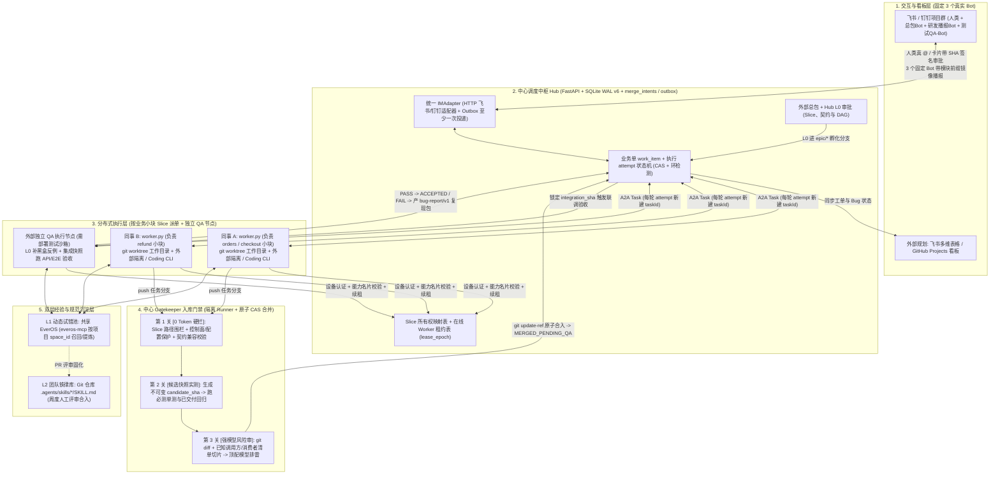
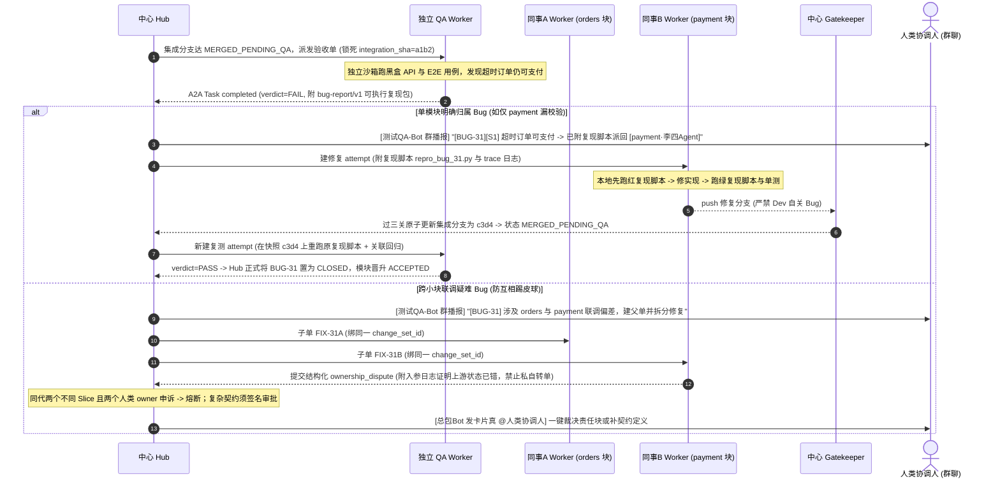

# 多人多 Agent 并行协同开发总体架构蓝图（v2.0：业务切片制 + 独立 QA 闭环）

> 实现状态：v0.1.0 参考协调器完成五轮对抗工程加固；当前为单机 SQLite WAL v6 + Git CAS。证据见 [Round 5 报告](round5_report.md)，权威状态见 [状态转换表](state_transitions.md)。OS/容器隔离、真实 IM 租户、TLS 与 Git ref ACL 属于外部部署前提，未宣称验收。下文标注为外部或规划的调度、看板与记忆组件不属于现成产品能力。

> [!IMPORTANT]
> **v2.0 核心升级（经 `gpt-6-astra` 深度挑刺校准）**：
> 1. **分工模型重构**：取消死板的“前端/后端岗位横切”，改为 **「垂直业务小块责任制（Slice Ownership）」**——每人负责自己那块的前后端与单测，跨块只读不写。
> 2. **四态严格解耦**：**Agent 执行结束（Attempt `completed`）≠ 门禁合入（`MERGED_PENDING_QA`）≠ 集成验收通过（`ACCEPTED`）≠ 可发布**。
> 3. **新增独立 QA 闭环**：QA 在 L0 阶段独立写受保护黑盒/联调用例，在合入集成分支后基于固定快照跑独立验收，通过**可执行复现包（`bug-report/v1`）**与研发交互，研发无权自关 Bug。
> 4. **群聊 Bot 收敛**：不为每个业务小块建机器人，群内固定只放 **3 个真实应用 Bot**（`总包Bot`、`研发播报Bot`、`测试QA-Bot`），消息头带 `[模块名 · 责任人Agent]` 逻辑身份。

---

## 一、 `gpt-6-astra` 抓出的 6 个致命工程漏洞及修补方案

| 编号 | 原 v1 蓝图的隐藏漏洞 | 线上真实故障时间线 | v2.0 最小手术刀修补 |
| :--- | :--- | :--- | :--- |
| **1** | **业务工单与 A2A 任务混成一张状态图** | A2A 规范中 `completed` 是终态不可复活；门禁打回若复用旧 A2A Task 发消息会直接协议报错。 | 拆为 **`work_item`（长期业务单）+ `attempt`（单次 A2A 执行，共享 `contextId`）**。门禁或 QA 打回时，业务单进 `REWORK` 并新建 `attempt`。 |
| **2** | **L0 红灯测试全入分支导致首单卡死** | 大需求所有模块的红灯验收单测先入分支，第一个交单的模块会因别人未开工而全红永远过不了门禁。 | 用例分级登记：门禁强制跑 **「本单必测 + manifest accepted + 已 `ACCEPTED` 模块必测回归」**；未开工模块标 `PENDING`（不计入通过率，Epic 收口要求 `PENDING == 0`）。 |
| **3** | **弱 Agent 篡改配置制造“0 测试假绿灯”** | 只禁改 `tests/**` 不够，弱模型会改 `pytest.ini`、`conftest.py` 或加 `skip` 让测试跳过返回 0。 | 将测试配置、公共 fixture、依赖锁纳入中央保护路径；门禁从可信基线加载套件，强校验 **`collected >= expected` 且未授权 `skipped == 0`**。 |
| **4** | **Redis 合并锁过期导致“测的不是合的”** | 跑回归超时导致 Redis 锁释放，另一单先推进了集成分支，旧单醒来直接 merge 产生未验证组合。 | 门禁锁死 `base_sha + source_sha -> candidate_sha` 跑验证；最终只用 **`git update-ref <branch> <candidate_sha> <base_sha>`** 原子 CAS 更新，基线变了立即作废重验。 |
| **5** | **冻结锁升级死锁 & 单槽 Worker 自锁** | ① A 块等 B 块 v2、B 块等 A 块 v2；② Worker 单槽挂着 `input-required` 等补丁，补丁又派给自己永远卡住。 | ① `input-required` 落库后**立即释放本地执行槽**；② 建依赖边强制做事务内 **DAG 环检测**；③ 互赖变更绑同一 `change_set_id` 组合验证合入。 |
| **6** | **飞书卡片双击/旧版回调误放行 & 3s 超时** | 审批人点了已被覆盖的旧版 L0 卡片触发错误派单；或在回调里同步调大模型超过飞书 3s 限制报错。 | 卡片回调绑 `approval_id + l0_commit_sha + state_version` 做 CAS 去重；回调先写库再返回（延迟 SLA 未验收），后台异步派单（Transactional Outbox）。 |

---

## 二、 全局五层拓扑图（Slice 切片制 + 独立 QA 版）



---

## 三、 “每人负责一小块（Slice Ownership）”怎么运作？

### 1. 仓库级 Slice 清单（解耦“模块—人—机器”）
不再按前后端切权限，而是在仓库受保护目录维护 `slices/<slice_id>.yaml`（公共底座单独设为 `shared-core` Slice，杜绝“人人能改等于没人负责”）：

```yaml
# slices/refund.yaml
slice_id: refund
owner_user_id: ou_lisi          # 主责同事飞书/钉钉 ID
backup_user_id: ou_zhangsan     # 备份同事（仅人工授权时启用）
owned_paths:                    # 纵切：该同事可同时改这一小块的后端、前端与单测
  - app/refund/**
  - web/src/features/refund/**
  - tests/unit/refund/**
provides_contracts:
  - refund-api@v1
consumes_contracts:
  - orders-api@v1
  - payment-api@v1
```

* **单任务最小写权限**：`allowed_paths = (本次工单声明路径 ∩ Slice owned_paths) - 中央保护路径`（中央保护路径含 `slices/**`、`contracts/**`、`tests/qa_e2e/**`、`migrations/**`、`pytest.ini`）。跨块代码**全仓可读，严禁顺手改**。
* **Agent Card 注册逻辑**：同事本地起 `worker.py` 时，A2A `agent-card.json` 只声明**客观技术能力**（如支持 `python`、`react`、流式输出）与身份签名，**不靠自报获得权限**；`Hub` 验签后查 `slices/*.yaml` 将该同事名下的 `slice_id` 绑定到该在线 Worker，自动按模型强弱拆单仍属外部协调器规划，不由本 Hub 实现。

### 2. 跨小块依赖协商（按契约提供方路由，不按前后端路由）
当负责 `refund` 块的同事 B Agent 发现 `orders-api` 缺 `expire_time` 字段时：
1. Worker B 抛出 A2A `input-required`（附目标契约 `orders-api`、期望字段语义与时区约定），**保存上下文后立即释放本地执行槽**。
2. `Hub` 查 `provides_contracts` 定位到 `orders` 块的同事 A：先做**去重检查**（是否已有同类补丁单）与 **DAG 环检测**，再派发契约补丁单给同事 A（若涉及改已冻结契约则先弹群卡片让负责人批准）。
3. 补丁单过 Gatekeeper 合入且独立 QA 接受后，`Hub` 把 **「新契约版本 + 最新集成分支 `commit_sha`」** 一起传回给同事 B，由 `worker.py` 创建新 `attempt` 并基于含真实现的新基线继续开发（绝不只是传一纸空文档）。

---

## 四、 独立测试（QA）与研发（Dev）完整协同闭环

### 1. 职责切分：Gatekeeper 管“能不能进分支”，QA 管“业务对不对”
* **L0 阶段（防自出卷自答卷）**：总包产接口契约骨架的同时，**独立唤醒 QA Agent** 从用户需求出发编写黑盒验收、边界反例与跨块联调用例，存入受保护目录 `tests/qa_e2e/**`（任何研发 Worker 均无写权限）。
* **提交门禁（Gatekeeper）**：只跑研发单测、契约兼容性和快速构建，过了之后业务单状态变为 **`MERGED_PENDING_QA`**（仅代表合入 `epic/*` 集成分支，**未验收、不加稳定锁**）。
* **集成验收（QA Worker）**：`Hub` 锁定当前集成分支 `integration_sha`，在独立隔离的 `qa_run_id` 环境（独立测试 DB + 独立 Redis 前缀 + 独立测试账号）启动真实前后端服务，派 A2A 验收单给 QA Agent。只有 QA 返回 `verdict = PASS`，相关模块才晋升为 **`ACCEPTED`** 并写入稳定版契约保护表。

### 2. QA 抓到 Bug 后怎么跟研发沟通？（全链路时序）



### 3. 标准 Bug 交接包裹（`bug-report/v1` Artifact 核心字段）
QA 给研发传的不是口水话，而是机器可直接重放的结构化证据：
* `target`: `integration_sha`、契约版本号字典、测试数据 `seed`；
* `reproduction`: 一键复现命令（如 `pytest tests/qa_e2e/repro_bug_31.py`）、前置条件、期望结果 vs 实际结果；
* `evidence`: 请求链路 `trace_id`、脱敏服务端错误日志切片、违反的具体契约条款；
* `routing_hint`: `suspected_slices: ["payment"]`（仅作路由建议，最终归属由 `Hub` 查契约表或人工裁决）。

---

## 五、 硬性熔断阈值表（按“有效往返轮次 + 截止时间”双控）

| 协作异常场景 | 自动上限 | 触发熔断后的确定性动作 |
| :--- | :---: | :--- |
| 跨小块 `input-required` 接口协商未果 | **3 轮** | 挂起工单，`总包Bot` 发群卡片真 `@` 技术负责人拍板契约 |
| 同一 Bug 研发连续提交修复但 QA 复测仍挂 | **3 轮** | 停止自动派修复单，防无效烧 Token，转人工排查根因 |
| 跨模块 Bug 研发提交 `ownership_dispute` 申诉 | **同代 2 个不同 Slice 且 2 个不同人类 owner** | 锁定父单与子单；签名 resume 开启新代、清零当代计数并保留历史，恢复不等于自动改派责任块 |
| 契约含糊 / 破坏性契约变更 / 越权改保护文件 | **0 轮** | 零容忍当场拦截，必须走带 `subject_digest` 签名的群卡片审批 |
| QA 同一快照测试忽绿忽红（Flaky Test） | **重跑 1 次** | 标记 `FLAKY_BLOCKED` 交 QA 负责人修用例，严禁刷出一次绿灯蒙混过关 |
| 测试沙箱/容器启动等纯环境故障 | **重试 2 次** | 标 `BLOCKED_ENV` 通知运维/负责人，**不扣减研发修复轮次** |

---

## 六、 当前持久化结构（SQLite WAL，schema user_version=6）

实际字段以 `store.py` / `workflow.py` 的 DDL 与原子迁移为准，不是 PostgreSQL 后端：

| 表 | 当前职责与关键字段 |
|---|---|
| epics | id, branch, skeleton_sha, state, version, release_sha；L0 到发布封印 |
| work_items | kind, slice_id, owner, parent_id, change_set_id, epic_id, state, version, epoch, integration_sha；协商、重做、仲裁与 QA 异常计数 |
| attempts | work_item_id, worker_id, epoch, version, state, expires, base_sha, source_sha, artifact；单次执行与租约 |
| dependencies | item, needs；事务性 DAG 防环与下游等待 |
| merge_intents | branch, base_sha, candidate_sha, items, evidence_json, state, request_id/request_digest；PREPARED / COMMITTED / STALE 恢复日志 |
| disputes | item, target, generation, slice_id, owner, worker, evidence；同代模块与人类唯一约束，历史不删 |
| approvals | item, subject_digest, expected_version, expires, action, approved_by；精确版本签名审批 |
| inbox | id, digest, result；入口幂等与原响应快照，旧 ID-only 行保留兼容 |
| outbox | topic, payload, available, claim, claimed_until, tries, delivered, dead_letter, priority, replay_count；租约投递与审计 |
| outbox_destinations | destination_id, provider, enabled, created_at; registered delivery targets |
| outbox_deliveries | event_id + destination_id; independent leases, retry budgets, DLQ and provider receipts |
| card_projections | approval_id + destination_id; provider card IDs and monotonic rendered state |
| workers | worker_id, owner_user_id, endpoint_url, skills, expires；认证映射与在线能力 |
| accepted_slices | slice_id, integration_sha；持久化回归范围 |

Slice 所有权来自受保护 registry YAML，契约文件来自 Git `contracts/`，并不存在蓝图早期
设想的 `slice_contracts` 或合并的 `approvals_and_outbox` 表。启动与迁移在一个
BEGIN IMMEDIATE 事务内；冲突历史仲裁数据应停机审计，禁止静默删除。

签名 resume：聚合父单 REWORK；叶子依次检查 L0、未满足依赖、owner 在线性，否则 REWORK。
依赖全接受后，按 COMMITTED merge_intents.rowid 选择最新依赖快照（包括既有 pin），
而不是最后 QA 回执的 SHA；Gatekeeper 仍逐条检查每个依赖 SHA 同时为提交基线与目标
分支祖先，跨分支不能仅信任一个 scalar pin。

Schema 是有界 producer-additive 策略，不是通用双向 JSON Schema 蕴含证明。新增可选字段
及其引用只允许 Positive Habitable Additive Profile；复杂约束须明确 breaking_contract 签名。
Outbox 紧急优先级 10，等待至少 300 秒的普通事件提升到 10，随后按 available/id 排序；
单事件人工 DLQ replay 默认最多 3 次（内部可信接口可指定 1..10），没有自动重放风暴。

## 七、 实施与部署边界

当前支持单机本地盘 SQLite 与单一授权 Git ref 发布者，不支持共享网络盘或多 Hub HA。
PostgreSQL、远程容器 runner 属于未来扩容选项。拓扑中的看板、模型自动拆单、独立 QA
沙箱编排、长期记忆分层推广与真实 Bot 租户创建仍需外部系统；仓库只提供明确接口和
受测参考流程。测试可验证状态与协议不变量，不能替代 OS 隔离、真实租户鉴权、TLS
反向代理和 Git 服务 ACL 的上线验收。worktree 不是安全沙箱。

聚合父单依赖由每个叶子继承；父依赖变更不得影响已派发子单。DAG 检查把同一
change_set_id 折叠为一个原子验收单元，拒绝组内与跨组传递环。父子必须绑定同一 Epic，
prepare_merge 重新验证父 Epic 的 ACTIVE 状态与目标分支，旧不一致数据也 fail closed。

Milestone B dual-IM integration and deployment boundaries: [integration guide](milestone-b.md).

Milestone C implements scoped engineering memory and the embeddable `HubRuntime`
control loop over the existing Store state machine. See [Milestone C](milestone-c.md)
for implemented scope, schema v6, optional export and local-vs-live acceptance limits.
